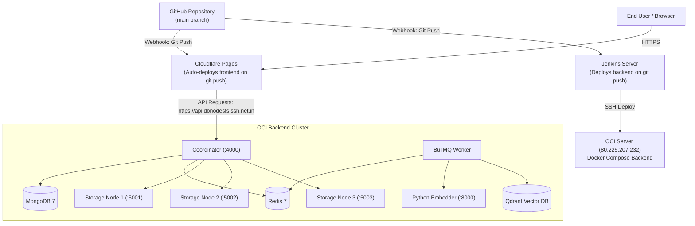

# DBNodesFS — End-to-End Deployment Plan

This document details the complete end-to-end deployment architecture, prerequisites, pipeline configuration, and maintenance operations for DBNodesFS across:
1. **Cloudflare Pages** (Frontend SPA connected directly to Git).
2. **Oracle Cloud Infrastructure (OCI) ARM64 Server** (Backend Docker Compose cluster).
3. **Jenkins Server** (Automating backend updates on OCI via SSH).

---

## 1. Architecture Overview



### Separation of Responsibilities:
- **Cloudflare Pages**: Connected directly to GitHub. Whenever you push to `main`, Cloudflare automatically builds and deploys the static frontend. Jenkins does not need to build or upload frontend assets.
- **Jenkins**: Triggers on `main` push, SSHs into the OCI server, pulls latest code, and runs `docker compose up -d --build --scale web=0`.
- **OCI Server**: Runs the 7 backend services (`coordinator`, `worker`, `embedder`, 3 `storage-nodes`, `mongo`, `redis`, `qdrant`). The `web` container is scaled to 0 since Cloudflare Pages serves the UI.

---

## 2. Server & Environment Setup

### 2.1 OCI Server Preparation (`80.225.207.232`)
1. **Add Swap (Recommended for builds)**:
   ```bash
   sudo fallocate -l 4G /swapfile
   sudo chmod 600 /swapfile
   sudo mkswap /swapfile
   sudo swapon /swapfile
   echo '/swapfile none swap sw 0 0' | sudo tee -a /etc/fstab
   ```

2. **Verify Port Availability**:
   Ensure ports required by DBNodesFS do not conflict with existing services:
   ```bash
   sudo ss -tulpn | grep -E ':(4000|27017|6379|6333|8000|5001|5002|5003)\b'
   ```

3. **Backend Network Exposure Options**:
   The frontend calls `https://api.dbnodesfs.ssh.net.in`. Map that domain to port `4000`:
   - **Option A (Zero-Firewall Cloudflare Tunnel — Recommended)**:
     ```bash
     docker run -d --name cf-tunnel --restart unless-stopped --network host \
       cloudflare/cloudflared:latest tunnel run --token <YOUR_TUNNEL_TOKEN>
     ```
     Point `api.dbnodesfs.ssh.net.in` to `http://localhost:4000` in the Cloudflare Zero Trust dashboard.
   - **Option B (Direct OCI Ingress / Reverse Proxy)**:
     Open port `4000` in the OCI VCN Ingress Rules and iptables:
     ```bash
     sudo iptables -I INPUT 6 -m state --state NEW -p tcp --dport 4000 -j ACCEPT
     sudo netfilter-persistent save
     ```

### 2.2 Jenkins Server Preparation
1. **SSH Key for OCI**:
   Generate an SSH key on the Jenkins host if not already present:
   ```bash
   sudo -u jenkins ssh-keygen -t ed25519 -f /var/lib/jenkins/.ssh/id_ed25519_oci -N ""
   sudo -u jenkins cat /var/lib/jenkins/.ssh/id_ed25519_oci.pub
   ```
   Add that public key to `/home/ubuntu/.ssh/authorized_keys` on OCI (`80.225.207.232`).
   
   Test from the Jenkins host:
   ```bash
   sudo -u jenkins ssh ubuntu@80.225.207.232 "docker ps"
   ```

2. **Jenkins Credentials**:
   In Jenkins (`Manage Jenkins` -> `Credentials`):
   - Add **SSH Username with private key**:
     - ID: `oci-ssh-key`
     - Username: `ubuntu`
     - Private Key: content of `/var/lib/jenkins/.ssh/id_ed25519_oci`

---

## 3. Cloudflare Pages Configuration (GitHub Native)

In the Cloudflare dashboard:
1. Go to **Workers & Pages** -> **Create application** -> **Pages** -> **Connect to Git**.
2. Select repository: `Nithin0620/DBNodesFS`.
3. Configure settings:
   - **Framework preset**: `Vite`
   - **Build command**: `pnpm --filter @dbnodesfs/shared build && pnpm --filter @dbnodesfs/web build`
   - **Build output directory**: `apps/web/dist`
   - **Root directory**: `/`
4. In **Environment variables**:
   - `NODE_VERSION`: `22`
   - `VITE_API_URL`: `https://api.dbnodesfs.ssh.net.in`
5. Click **Save and Deploy**. Cloudflare Pages will rebuild whenever you push to `main`.

---

## 4. Jenkins Pipeline (`Jenkinsfile`)

Since Cloudflare Pages handles the frontend natively, the `Jenkinsfile` only handles backend deployment to OCI:

```groovy
pipeline {
    agent any

    environment {
        OCI_HOST = 'ubuntu@80.225.207.232'
        DEPLOY_DIR = '/home/ubuntu/dbnodesfs'
        REPO_URL = 'https://github.com/Nithin0620/DBNodesFS.git'
    }

    stages {
        stage('Deploy Backend to OCI') {
            steps {
                sshagent(['oci-ssh-key']) {
                    sh '''
                        ssh -o StrictHostKeyChecking=no ${OCI_HOST} "
                            set -e
                            if [ ! -d ${DEPLOY_DIR} ]; then
                                git clone ${REPO_URL} ${DEPLOY_DIR}
                            fi
                            cd ${DEPLOY_DIR}
                            git fetch --all
                            git reset --hard origin/main
                            docker compose up -d --build --scale web=0 --remove-orphans
                        "
                    '''
                }
            }
        }
    }

    post {
        failure {
            echo "❌ Backend deployment to OCI failed. Check logs above."
        }
        success {
            echo "✅ Successfully deployed backend cluster to OCI! (Cloudflare Pages auto-deploys frontend independently)."
        }
    }
}
```

---

## 5. One-Command Teardown & Complete Wipe

To safely delete all DBNodesFS services, databases, vectors, and chunks without disturbing any other services or databases on the OCI server:

Run inside `/home/ubuntu/dbnodesfs` on OCI:
```bash
docker compose down -v --remove-orphans
```
*(Removes all DBNodesFS containers and persistent data volumes: `node1-data`, `node2-data`, `node3-data`, `mongo-data`, `redis-data`, `qdrant-data`).*
